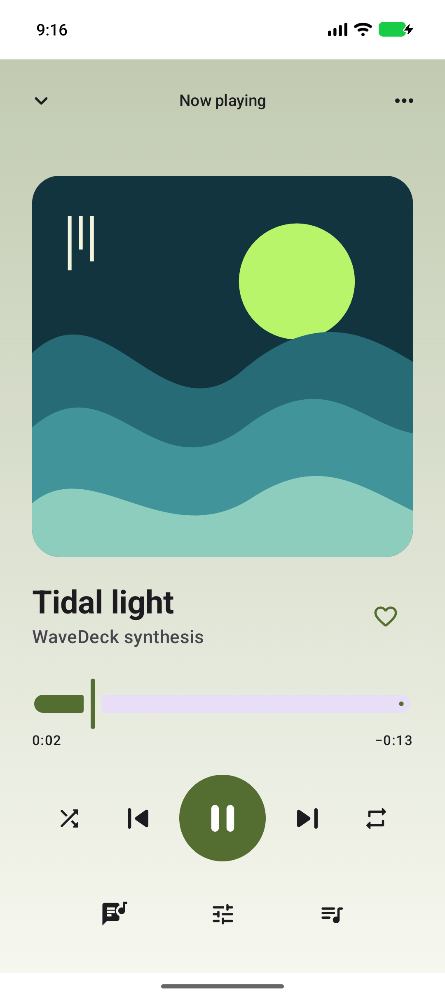
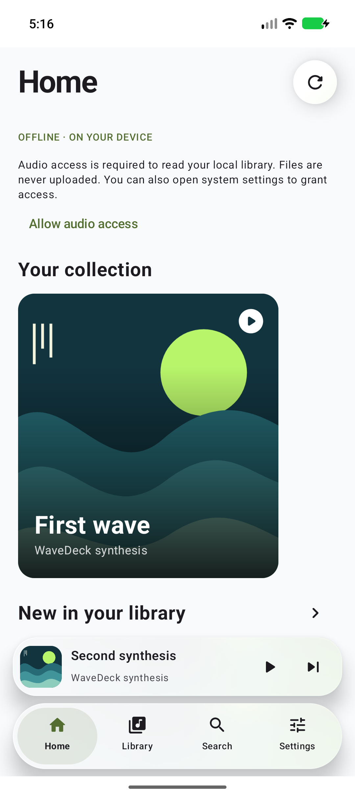
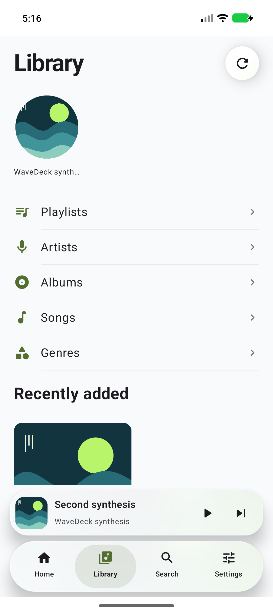
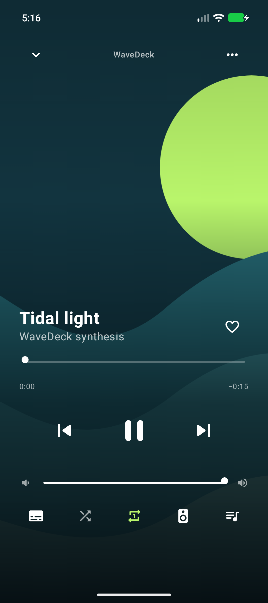
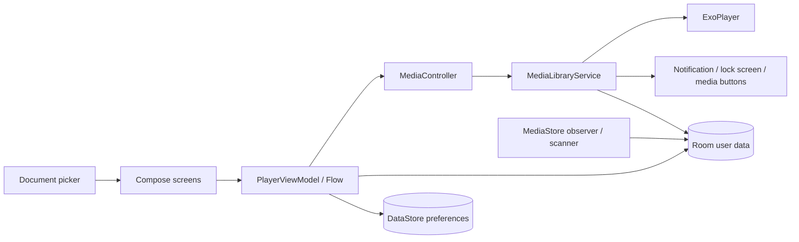

# ≋ WaveDeck — Day 015

**Your music. Your space.** A personal, offline Android audio player with an original teal-and-lime identity, a service-owned playback engine and a configurable Compose interface.

Version `1.0.0-test.2` is a test candidate; a successful build is not a claim of universal device compatibility or completed production certification.

### Implemented

- MediaStore audio discovery, content-observer refresh, reconciliation of removed files and preservation of user annotations. Songs, albums, artists, supported genres, folders, favorites, recent/most played and bounded history.
- Media3 ExoPlayer hosted in a MediaLibraryService: background playback, system media notification, lock-screen/media-button integration, audio focus, unplug pause, play/pause, seek, previous/next, shuffle, repeat, speed and service-owned sleep timer.
- Persistent queue, position, repeat, speed and shuffle preferences; play-next, enqueue, move and remove. Playback restoration remains paused until requested.
- Room playlists with create, rename, delete, add/remove tracks; search and multi-select. Built-in favorites, recent/most-played collections serve as smart views.
- SAF import/export of M3U8 playlists. Exports use relative MediaStore paths when known and content URIs otherwise. Imports match local paths/URIs or a unique filename; unmatched or ambiguous entries are skipped and reported. Cross-device URIs are not portable.
- Local plain/LRC lyrics import and editing, multiple timestamps, fractional timestamps, file offset, per-track manual offset, active-line highlighting and tap-to-seek. No lyric scraping or included commercial lyrics.
- Exactly two complete design systems: **Material Design** and **Liquid Glass**. Glass changes home, library hierarchy, navigation, mini-player, typography, selection controls and fullscreen Now Playing. Six optional player layouts remain within Material Design: Classic, Immersive, Compact, Vinyl, Minimal and Expressive. Portrait/tablet layouts and glass sidebar support.
- System/light/dark/AMOLED appearance; Material Design/Liquid Glass presentation; wallpaper color on Android 12+, five accent presets/custom HEX, corners, artwork backgrounds, blur, opacity, spacing/text scale, album grids, mini-player/navigation/seek-bar variants, reduced motion/effects.
- Original Liquid Glass presentation with editorial artwork cards, circular artist carousel, category rows, frosted pill navigation, floating mini-player and full-bleed artwork player with real media-volume control. Translucent surfaces have edge highlights and a local artwork underlay. Android 12+ can blur the artwork layer; this is not true optical refraction or arbitrary live backdrop sampling. Earlier devices retain the tinted/translucent fallback.
- Material 3 presentation with expressive asymmetric artwork framing, shape hierarchy and larger player controls, built from stable Material 3 1.4 components. No unstable Expressive dependency is required.
- Optional real Android Visualizer waveform capture with bar/line rendering. Requires an explicitly requested audio permission and a supported audio session. Failure never stops playback. The decorative wave seek bar is separate from this capture.
- System equalizer control-panel handoff with the playback audio-session ID, availability fallback, and system sound-output settings. Codec/MIME, size, duration, bitrate and sample rate are shown when retrievable.
- A resizable home-screen player widget, app shortcut, MediaBrowser library root/paginated children and original adaptive/monochrome icons. Android Auto host certification is not claimed.
- English, Русский and Қазақша resources, locale-aware track plurals, System/app language selection, locale key and placeholder tests.
- Optional 16-second synthetic PCM demo and original vector cover. It is synthesized locally from sine waves, not downloaded or copied music.

### Preview

Actual-app captures are in [`docs/screenshots`](docs/screenshots). See [`BUILD_REPORT.md`](BUILD_REPORT.md) for what was actually built and tested.

| Material Design | Glass home | Glass library | Glass player |
| --- | --- | --- | --- |
|  |  |  |  |

### Stack and architecture

Kotlin / Compose / Material 3 / AndroidX Media3 / Room / DataStore / Coroutines and Flow / Navigation Compose / Coil. Minimum Android 8.0 (API 26), compile/target Android 17 (API 37). AGP 9.4.1, Gradle 9.6, Compose compiler 2.2.20. Dependency versions are pinned for reproducibility; upgrades should repeat the playback tests.



One Gradle module with explicit `data`, `model`, `media`, and `ui` packages keeps local builds straightforward. There is no DI framework or unnecessary worker scheduling. See [ARCHITECTURE.md](ARCHITECTURE.md).

### Build and test

Open the folder containing `settings.gradle.kts` in Android Studio. Install Android SDK Platform 37 and Build Tools 36.0.0 or newer. Use the IDE's compatible Gradle JDK (17+; this delivery used Studio's JDK 25).

```powershell
$env:JAVA_HOME = 'C:\Program Files\Android\Android Studio\jbr'
$env:ANDROID_HOME = "$env:LOCALAPPDATA\Android\Sdk"
.\gradlew.bat :app:testDebugUnitTest :app:lintDebug :app:assembleDebug
# Start an emulator or attach your own Android device:
.\gradlew.bat :app:connectedDebugAndroidTest
.\gradlew.bat :app:assembleRelease
```

On macOS/Linux use `./gradlew` with a configured JDK and SDK. The first build resolves Maven dependencies and the Gradle distribution; app playback does not use the internet. Debug APK: `app/build/outputs/apk/debug/app-debug.apk`. Release output is **unsigned** until you configure your own signing key. See [BUILD_APK_RU.md](BUILD_APK_RU.md).

### Formats, privacy and limitations

Playback follows [Media3 supported formats](https://developer.android.com/media/media3/exoplayer/supported-formats) and the codecs actually available on the device. Common MP3/AAC/FLAC/Vorbis/Opus/PCM containers may work where supported; extensions alone do not guarantee decodability. No bit-perfect, Hi-Res, DRM, DSD, normalization, crossfade or DSP quality claim is made.

No internet permission, accounts, analytics, telemetry or cloud backend. Audio permission is used for MediaStore; SAF restricts access to selected documents. Optional RECORD_AUDIO is solely for the visualizer. Foreground-service/wake-lock permissions support background audio. Android app-data backup is disabled. See [PRIVACY.md](PRIVACY.md).

This candidate does **not** implement a custom DSP/equalizer, bass/virtualizer processing, mono/balance, ReplayGain, crossfade, an FFT spectrum, embedded lyric extraction, draggable queue gestures, arbitrary user-defined smart-playlist rules or shared-element artwork morphing. A single resizable widget is supplied rather than two separate widget products. Library refresh reconciles a complete MediaStore scan; it is not a generation-based incremental index. Lazy rendering and background scanning are in place, but tens-of-thousands-track benchmarks and a physical-device matrix still need to be run.

### Before a public release

Follow [TEST_CHECKLIST.md](TEST_CHECKLIST.md), test your own music/device/headset, review translations with native speakers, validate old SDK fallbacks and large-library performance, supply your signing key and capture release screenshots. No automatic GitHub publish is configured.

## License

MIT for WaveDeck source, vector assets and synthetic demo. Third-party dependencies retain their respective licenses; see [THIRD_PARTY_NOTICES.md](THIRD_PARTY_NOTICES.md).
